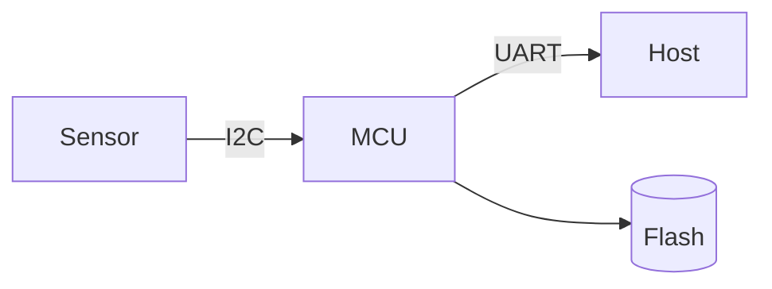
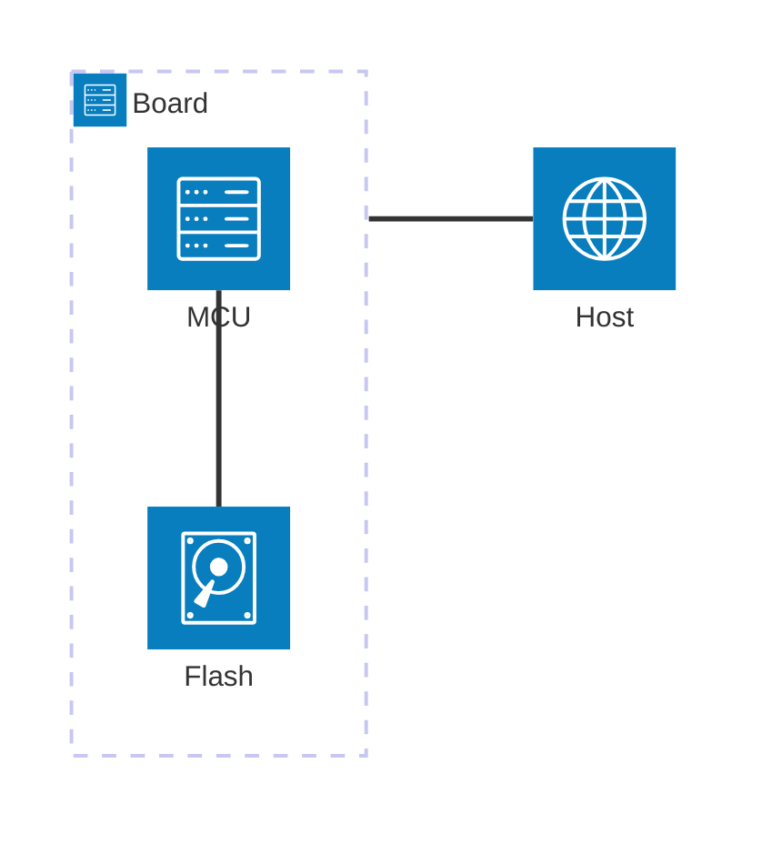
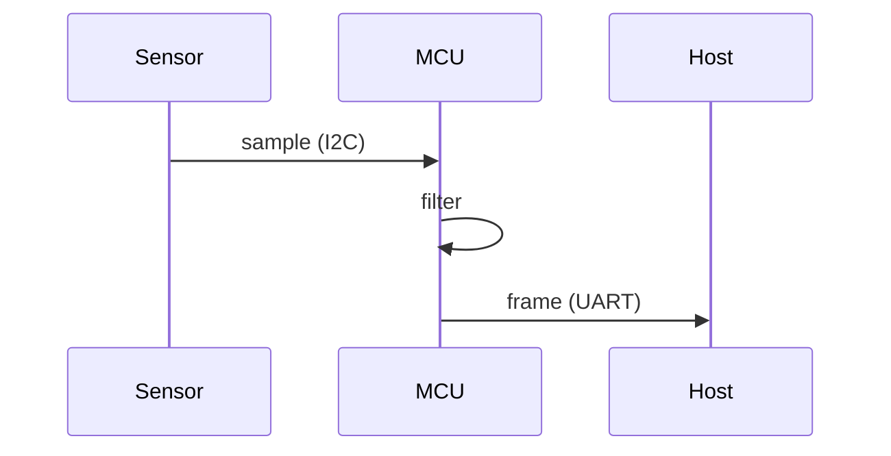

# Architecture

> Tab label on the site: "architecture". The file name is the label — rename the file to rename the tab.

## Block diagram

A fenced block marked `mermaid` is drawn as a diagram when the site is built (by [pele](https://pele.run), no JavaScript in the browser). It follows the site's light and dark theme, and the Mermaid text sits behind "Show diagram source".

## System architecture

`architecture-beta` draws services in groups, with the sides the connections leave from (`T`, `B`, `L`, `R`). The icons are `cloud`, `database`, `disk`, `internet` and `server`. A `{group}` after a service makes the line end on its group's edge instead of crossing it.

Other diagram types work the same way: `sequenceDiagram`, `stateDiagram-v2`, `classDiagram`, `erDiagram`, `gantt` and the rest of Mermaid. A diagram with a typo shows the error and its source on the page instead of breaking the build.

## Hardware

Main parts and why they were chosen. The interactive schematic, PCB and 3D view
are generated from the `PCB/` folder, so no need to embed them here.

| Part | Role | Why this one |
| --- | --- | --- |
| MCU | | |
| Power | | |

## Firmware / software

Modules, how data flows between them, and the one design decision that matters most.

## Trade-offs

What you gave up, and why that was acceptable.
